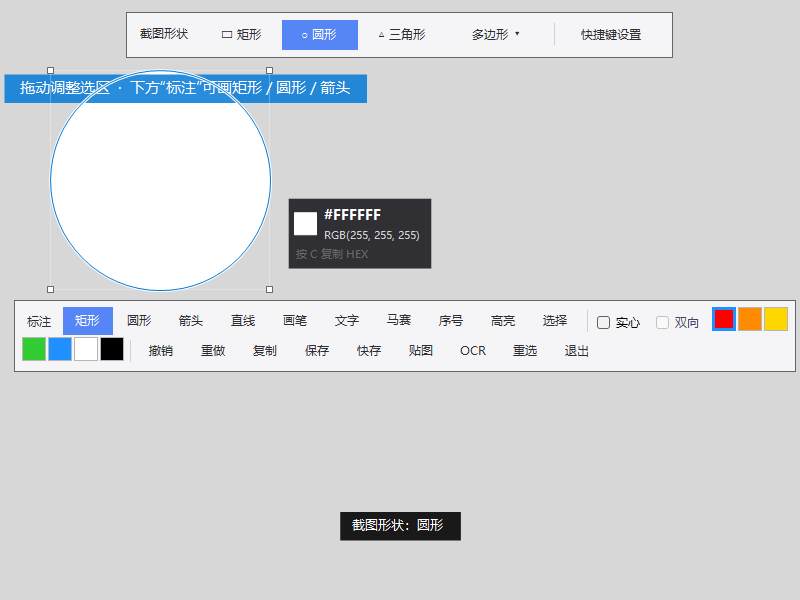
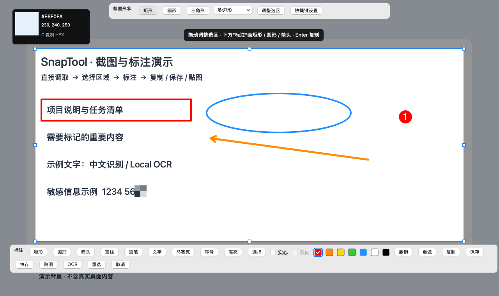
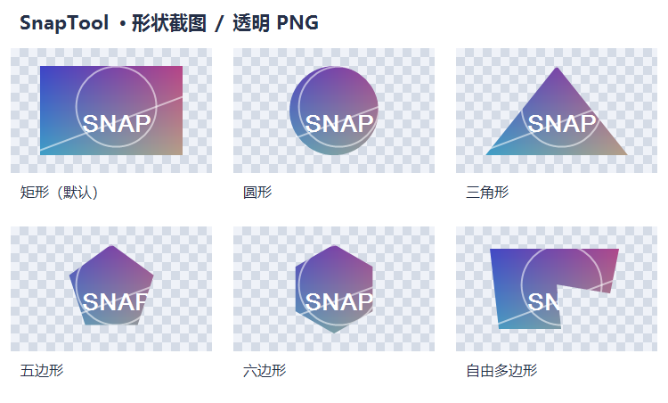
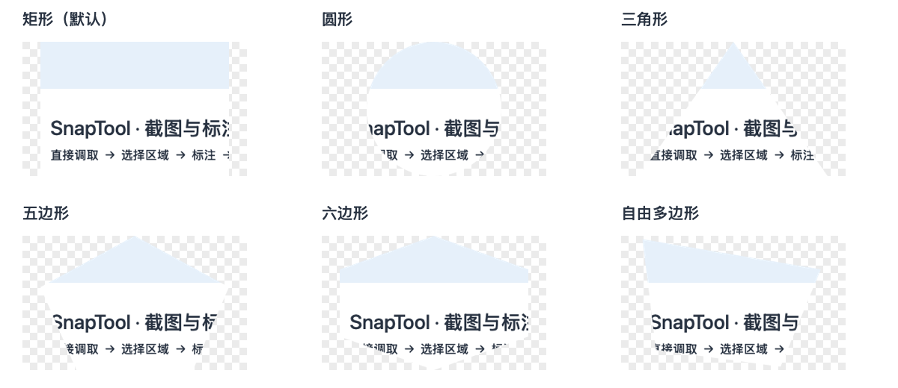
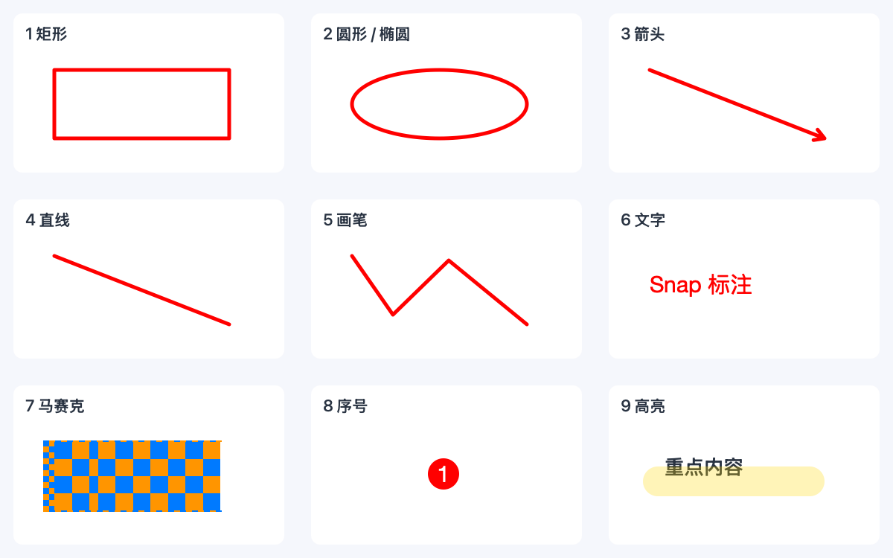
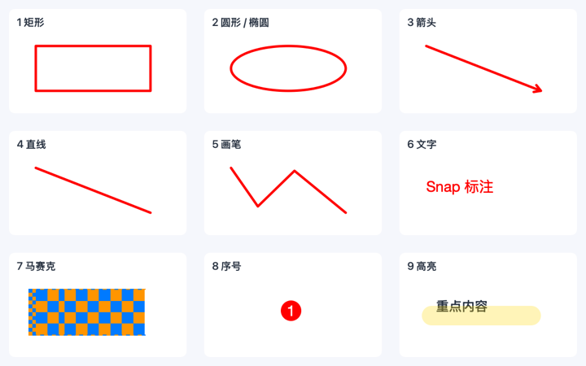
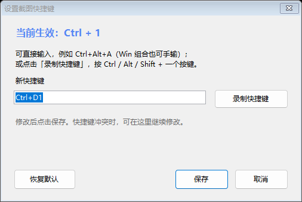
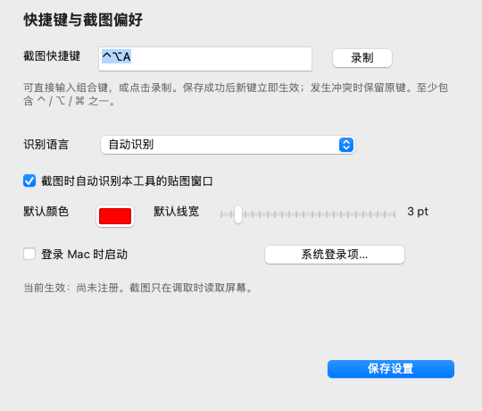

# SnapTool · 轻量截图与标注工具


快捷键调取、框选截图、画圈标重点，再复制、保存或贴在桌面上。SnapTool 提供 Windows 与原生 Mac 版本，常驻系统托盘 / 菜单栏，不需要账户；截图和 OCR 在本机处理。

## 下载与兼容

| 版本 | 适用电脑 | 下载 |
| --- | --- | --- |
| **Windows v1.4.0 · 稳定版** | Windows 10 / 11，系统提供 .NET Framework 4.8 | [下载便携 ZIP](https://github.com/kelingfeng9/SnapTool/releases/download/v1.4.0/SnapTool-v1.4.0.zip) · [版本说明](https://github.com/kelingfeng9/SnapTool/releases/tag/v1.4.0) |
| **Mac v1.0.1 · 开发预览版** | Apple 芯片，macOS 14 及更新版本 | [下载 Mac ZIP](https://github.com/kelingfeng9/SnapTool/releases/download/mac-v1.0.1-preview.1/SnapTool-macOS-1.0.1-arm64.zip) · [版本说明](https://github.com/kelingfeng9/SnapTool/releases/tag/mac-v1.0.1-preview.1) |

Windows 程序约 261 KiB，解压运行，无需安装器。Mac 使用原生 Swift / AppKit 应用，不需要额外运行时。Mac 预览包采用 ad-hoc 签名，尚无 Developer ID 签名和 Apple 公证；安装与授权见下文。

Mac 的编译、单元测试、打包与启动检查以 [macOS 构建记录](https://github.com/kelingfeng9/SnapTool/actions/workflows/macos.yml) 和对应版本说明为准。自动检查不等同于所有显示器、系统权限和桌面交互均已通过实机验证。

## 一分钟上手

1. Windows 解压后双击 `SnapTool.exe`；Mac 将 `SnapTool.app` 放入“应用程序”后打开。
2. 按 Windows **Ctrl + Alt + A**，或 Mac **Control + Option + A（⌃⌥A）** 调取截图。也可以从托盘 / 菜单栏选择“截图”或“开始截图”。
3. 拖动选择区域，或把鼠标放在目标窗口上，看到边框后单击选择。
4. 点击下方 **“标注”** 中的矩形、圆形、箭头等工具，在选区里绘制。
5. 按 **Enter** 复制图片；需要文件时点“保存” / “快存”，需要桌面参考图时点“贴图”。

**上方“截图形状”改变图片轮廓；下方“标注”在图片上画记号。** 圆形截图与圆形标注是两个不同用途的入口。

下图使用程序界面与绘制功能生成，内容为专用示例。系统主题、缩放比例和屏幕尺寸可能使工具栏换行或外观略有不同。

**Windows 截图界面**



**Mac 截图界面**



## 选择截图区域和形状

每次调取默认 **矩形**，**圆形** 位于第二位。截图顶部还提供三角形与多边形菜单。

| 截图形状 | 操作 |
| --- | --- |
| 矩形 | 直接拖动框选；适合窗口、网页片段和文档 |
| 圆形 | 点击顶部“圆形”后拖动，选区保持正圆 |
| 三角形 | 点击“三角形”后拖动确定外接区域 |
| 五边形 / 六边形 | 在“多边形”菜单选择，再拖动框选 |
| 自由多边形 | 在菜单选择“自由多边形”，逐点单击添加顶点，双击、点击首点或按 Enter 闭合 |

自由多边形绘制中，**右键、Backspace / Delete** 可撤回一个顶点；Windows 也可按 Ctrl + Z 撤点。至少三个顶点围成有效区域后才能完成。闭合后继续标注，再按 Enter 复制。

框选完成后，可以拖动选区移动，拖动边缘或角点调整大小。Windows 请在点击标注工具前完成选区调整；Mac 可点击顶部“调整选区”返回调整状态。圆形调整后仍保持正圆。需要重新选择时，点“重选”或按 Windows **Ctrl + R** / Mac **⌘R**；普通选区下右键也可重选。

**透明轮廓示例 · Windows**



**透明轮廓示例 · Mac**



### 自动选窗口与多显示器

未框选时，把鼠标移到窗口上，SnapTool 会显示候选边框和标题，单击即可选中。托盘 / 菜单栏的 **“截图时识别贴图窗口”** 决定自己的贴图是否参与这种自动选择；关闭它不会关闭已有贴图。

使用外接显示器时，先将鼠标放到要截图的显示器，再调取并框选。Mac 在每块屏幕显示独立遮罩，同一轮截图共享选区、标注与撤销，可以跨屏拖动框选。屏幕连接、排列或缩放变化后重新调取截图，工具会读取当前屏幕布局。Mac 预览版的不同 Retina 缩放、Spaces 与外屏组合仍应按实际设备验证；这类问题反馈时请附上显示器排列和缩放设置。

## 在截图里标注与编辑

完成选区后，点下方 **“标注”** 工具，或按数字键切换。两端采用相同顺序：

| 数字键 | 工具 | 具体操作 |
| --- | --- | --- |
| **1** | 矩形 | 拖动绘制边框；勾选“实心”后填充区域 |
| **2** | 圆形 / 椭圆 | 拖动绘制；按住 Shift 画正圆，也支持“实心” |
| **3** | 箭头 | 从起点向终点拖动；勾选“双向”后两端均有箭头 |
| **4** | 直线 | 拖动绘制线段 |
| **5** | 画笔 | 按住鼠标自由绘制 |
| **6** | 文字 | 单击输入，Enter 提交，Esc 取消当前文字 |
| **7** | 马赛克 | 拖动覆盖区域，滚轮调整粒度 |
| **8** | 序号 | 单击添加递增的编号 |
| **9** | 高亮 | 按住鼠标绘制半透明笔迹 |
| **0** | 选择 | 点击已有标注，再移动、删除或修改样式 |

**Windows 九种标注示例**


**Mac 九种标注示例**



画矩形时按住 **Shift** 得到正方形；画圆形时得到正圆；画直线和箭头时按水平、垂直或 45° 方向约束。颜色按钮修改标注颜色；**滚轮、`[` / `]`** 调整当前工具的线宽、文字字号或马赛克粒度。

修改已有标注：按 **0** → 点击目标标注 → 拖动移动。空心图形点击边线，实心图形可点击内部；选中后按 **Delete / Backspace** 删除，或点颜色、调整粗细、切换“实心” / “双向”。文字提交后可移动、改颜色与字号；需要改文字内容时，删除原文字再重新输入。

用 Windows **Ctrl + Z** / Mac **⌘Z** 撤销，**Ctrl + Y / Ctrl + Shift + Z** 或 **⌘Y / ⇧⌘Z** 重做。没有选中标注时，Delete / Backspace 也可撤销最近的标注。文字正在编辑时，数字、退格、复制、粘贴与撤销优先用于文字编辑。

## 复制、保存、快存与贴图

| 输出方式 | 适合什么场景 | 操作和结果 |
| --- | --- | --- |
| **复制** | 粘贴到聊天、文档或图片编辑器 | 点“复制”、按 Enter / Ctrl + C / ⌘C，或双击选区；复制图片后结束截图 |
| **保存** | 选择文件名、目录和格式 | 点“保存”或 Ctrl + S / ⌘S，选择 PNG / JPEG / BMP；取消对话框可继续截图 |
| **快存** | 连续截图，不想反复选目录 | 点“快存”或 Ctrl + Shift + S / ⇧⌘S，保存到系统“图片 / SnapTool”，并把**文件路径**复制到剪贴板 |
| **贴图** | 对照、抄写、临时桌面参考 | 点“贴图”或 Ctrl + T / ⌘T，把图片浮在桌面上 |

**保留透明轮廓请选择 PNG。** 快存使用 PNG；形状贴图保留选区之外的透明部分。JPEG / BMP 使用白底。剪贴板提供透明图片格式，接收软件是否保留透明度取决于其格式支持；Windows 同时提供白底 Bitmap 兼容格式。

两端的“保存”均记住上次目录与格式，首次使用 PNG，也可在对话框中切换。需要透明轮廓时请选择 PNG。快存后 Ctrl + V / ⌘V 粘贴的是文件路径，想粘贴图片请使用“复制”。

### 贴图怎样用

两端均可 **拖动移动、滚轮缩放、Shift + 滚轮调整透明度**。缩放围绕鼠标位置进行，便于对照局部。贴图默认置顶，按 **T** 或右键菜单切换；双击或按 Esc 关闭。圆形、多边形的透明空白处允许鼠标操作下面的窗口。

Windows 贴图中 **Ctrl + C** 复制图片；右键提供复制、置顶和关闭。Mac 贴图中 **⌘C** 复制，右键还提供“另存为…”和“恢复大小与透明度”；**⌘S** 另存为，**⌘0** 恢复。



## 取色、OCR 与延迟截图

### 取色

截图界面会显示鼠标位置的像素颜色与局部放大图。**C** 复制 `#RRGGBB` 形式的 HEX；**未建立有效选区时**，Windows **Ctrl + C** / Mac **⌘C** 复制 RGB 文本。有选区时，同一组合键用于复制截图；正在输入文字时则用于复制文字。

### 本地文字识别

框选要识别的文字，点击 **“OCR”**，或按 Windows **Ctrl + Shift + O** / Mac **⇧⌘O**。识别使用选区的原始像素，标注不会加入 OCR 输入。结果显示在独立窗口中，可以选择、编辑和复制文字。

Windows 可从任务栏找回识别结果窗口；Mac 结果被遮挡或最小化时，可从菜单栏 **“OCR 识别结果”** 中重新打开。关闭结果窗口后，它会从该菜单移除。

在托盘 / 菜单栏 **“OCR 语言”** 里选择语言；Mac 也可在设置窗口修改。Windows 使用系统安装的识别语言包，缺少目标语言时先安装相应 Windows 语言功能；Mac 使用 Vision 当前支持的语言，自动模式优先处理中英文。引擎在本机工作，不向服务器发送图片或文字。

### 延迟截图

从托盘 / 菜单栏进入 **“延迟截图”**，选择 **3、5 或 10 秒**，随后打开需要截图的菜单、弹出提示或悬停内容。倒计时结束再选择区域；重复选择延迟会替换前一次倒计时。

## 快捷键设置与开机启动

### Windows

两个入口：**截图顶部“快捷键设置”**，或 **右下角托盘图标右键 → 设置快捷键…**。

输入组合键，例如 `Ctrl+Alt+A`；也可以点击“录制快捷键”后按组合键，再点击“保存”。“恢复默认”填入默认键，仍需保存。至少使用一个 Ctrl / Alt / Shift / Win 修饰键；Win 组合可手动输入，F12 为系统保留键。

快捷键冲突会显示原因并保留原键。托盘菜单 **“开机自启”** 控制当前用户登录时启动；**“截图时识别贴图窗口”** 和 **“OCR 语言”** 也在托盘中。



图中 `Ctrl + 1` 是设置演示值；首次运行的默认键为 **Ctrl + Alt + A**。

### Mac

两个入口：**菜单栏 → 快捷键与设置…**，或 **截图顶部“快捷键设置”**。

直接输入 `Ctrl+Option+A`、`Cmd+Shift+S`，或点击“录制”按下组合键，然后点击“保存设置”。至少包含 **Control / Option / Command** 中的一个，可同时使用 Shift；录制时 Esc 取消。新键注册成功才替换原键，冲突时保留旧键。

同一窗口还提供 **OCR 语言、默认标注颜色和线宽、识别贴图窗口、登录 Mac 时启动**。登录启动使用系统登录项服务；如果需要确认，点“系统登录项…”在 macOS 设置中允许。修改颜色或快捷键等偏好后记得保存；登录启动开关会立即向系统申请更改。



配图展示设置的位置；快捷键的生效提示与登录启动状态以你的实际窗口为准。

## 双端快捷键速查

Mac 的 **⌘ = Command、⌃ = Control、⌥ = Option、⇧ = Shift**。两端日常动作一致，Windows 常用 Ctrl，Mac 常用 Command。

| 动作 | Windows | Mac |
| --- | --- | --- |
| 默认调取截图 | Ctrl + Alt + A | ⌃⌥A |
| 复制截图 | Enter / Ctrl + C / 双击 | Enter / ⌘C / 双击 |
| 保存 | Ctrl + S | ⌘S |
| 快存 | Ctrl + Shift + S | ⇧⌘S |
| 贴图 | Ctrl + T | ⌘T |
| OCR | Ctrl + Shift + O | ⇧⌘O |
| 选标注工具 | 1–9 | 1–9 |
| 选择已有标注 | 0 | 0 |
| 撤销 | Ctrl + Z | ⌘Z |
| 重做 | Ctrl + Y / Ctrl + Shift + Z | ⌘Y / ⇧⌘Z |
| 删除已选标注 | Delete / Backspace | Delete / Backspace |
| 重选 | Ctrl + R / 右键 | ⌘R / 右键 |
| 取消截图 | Esc | Esc |
| 约束图形比例 / 角度 | Shift + 拖动 | Shift + 拖动 |
| 调整工具参数 | 滚轮 / `[` / `]` | 滚轮 / `[` / `]` |
| 复制 HEX | C | C |
| 无选区时复制 RGB | Ctrl + C | ⌘C |

Enter 在自由多边形绘制中用于闭合，在文字输入中用于提交；此时不会直接复制整张截图。贴图中的快捷键见上方贴图说明。

## 安装、更新与系统差异

### Windows 便携版

下载并解压便携 ZIP，运行 `SnapTool.exe`。托盘图标可能位于任务栏的隐藏图标区域。再次双击运行中的同一软件会调取现有实例的截图，无需重复启动进程。

更新前从托盘退出，保留原有 `SnapTool.config.txt`，替换 `SnapTool.exe` 后重新运行。设置通常保存在程序目录，目录不可写时改用 `%APPDATA%\SnapTool\`。更新时不要用包里的通用示例配置覆盖自己的配置。

### Mac 应用

解压后将 `SnapTool.app` 拖到“应用程序”，打开后从菜单栏操作；默认没有 Dock 图标。再次打开 SnapTool 时，新版会调取已有实例的截图，避免重复常驻和快捷键争用。

首次截图需要屏幕读取授权：**系统设置 → 隐私与安全性 → 屏幕录制**；较新系统名称为 **“屏幕与系统音频录制”**。允许 SnapTool 后按系统提示重新打开。软件不采集音频，全局快捷键不需要“辅助功能”或“输入监控”授权。设置路径以 [Apple 的授权说明](https://support.apple.com/guide/mac-help/control-access-screen-system-audio-recording-mchld6aa7d23/mac) 为准。

预览包仅 **ad-hoc 签名、未公证**。从本仓库下载的应用若被首次拦截，可按 [Apple 的未知开发者应用说明](https://support.apple.com/guide/mac-help/open-a-mac-app-from-an-unknown-developer-mh40616/mac)，在“系统设置 → 隐私与安全性”中选择“仍要打开”。不需要关闭系统全局安全保护。

更新前从菜单栏退出，替换“应用程序”里的旧 `SnapTool.app`，再打开新版；偏好保存在系统 UserDefaults 中。若系统重新要求屏幕授权，按提示允许。当前采用手动下载更新。

| 相同的使用方式 | 平台提供的不同界面 |
| --- | --- |
| 顶部截图形状、底部标注、矩形默认与圆形第二 | Windows 使用 WinForms；Mac 使用 AppKit，按钮、文字输入、文件对话框遵循各自系统 |
| 同样的标注顺序、颜色、撤销、输出和透明轮廓 | Windows 在右下角托盘常驻；Mac 在顶部菜单栏常驻 |
| 本地 OCR、延迟截图、自定义调取快捷键 | Windows 识别语言来自系统语言包；Mac 来自 Vision 支持列表 |
| 登录时自动启动 | Windows 托盘直接开关；Mac 使用系统登录项，可能需要系统确认 |

## 源码与验证

Windows 使用系统 WinForms / GDI+；Mac 使用 AppKit、ScreenCaptureKit、CoreGraphics 和 Vision。标注与截图交互保留在本地，不引入浏览器运行时或第三方服务。

**Windows 构建**

```powershell
powershell.exe -NoProfile -ExecutionPolicy Bypass -File .\build.ps1
powershell.exe -NoProfile -ExecutionPolicy Bypass -File .\build.ps1 -Test -OutputPath artifacts\RegressionTests.exe
```

构建输出在 `artifacts` 中，默认不覆盖正在使用的程序；也可双击 `build.cmd`。本地构建需要系统 .NET Framework 4.8、C# 编译器和 WinRT 元数据，不要求安装 Visual Studio。

**Mac 构建**

```bash
cd macos
swift test --arch arm64
bash scripts/build-app.sh
```

请在 Mac 上使用 Xcode 或 Xcode Command Line Tools。输出位于 `macos/build`；完整打包、签名范围及安装说明见 [Mac 手册](macos/README.md)。

更多资料：[开源工具对标与性能记录](对标与性能报告.md) · [Windows 修复与验证记录](修复报告.md) · [问题反馈](https://github.com/kelingfeng9/SnapTool/issues) · [所有版本](https://github.com/kelingfeng9/SnapTool/releases)。
